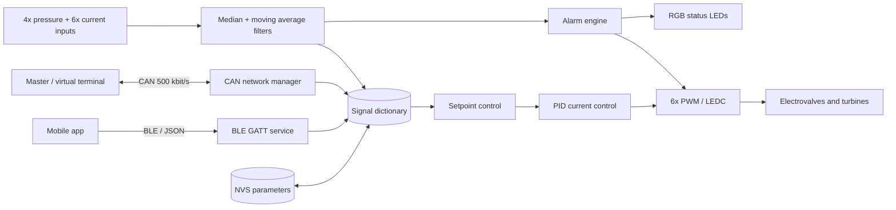

# SoilPressureControl V2 — Hydraulic Pressure Control Firmware

**Español:** [Leer en español](README.es.md)


Production-grade embedded firmware for **SmartPress**, an agricultural pressure-control
ECU that drives electrovalves and turbines with closed-loop PID current control.
It reads pressure and current sensors, runs a real-time alarm engine, and exposes the
whole machine through a **CAN network** and a **BLE mobile app**.

Built on **ESP32-C6** with **ESP-IDF 5.3**, **FreeRTOS**, C and C++.

---

## Why this project stands out

- **Real-time control:** 6 independent PID loops at a 10 ms period, current-mode
  control of hydraulic actuators with ramp/slew limiting and open-circuit detection.
- **Embedded systems breadth:** ADC + external I2C ADC, PWM/LEDC, WS2812 status LEDs,
  NVS persistence, BLE GATT, CAN/TWAI and FreeRTOS — end to end, on one MCU.
- **Production concerns:** parameter calibration, alarm thresholds with debounce
  timers, signal dictionary, CRC-32 helpers, build stamped with the git commit hash,
  conventional-commit linting in CI.
- **Clean modular architecture:** hardware, signal processing, control, communications
  and diagnostics are separated into dedicated modules and tasks.

---

## What the firmware does

| Capability | Detail |
|---|---|
| Hydraulic outputs | 6 PWM outputs (LEDC) for electrovalves, turbines or siren |
| Closed-loop control | Per-output PID on measured current, configurable P/I/D and sample time |
| Pressure sensing | 4 analog pressure inputs through an external **TLA2528** 8-channel I2C ADC |
| Current sensing | 6 ADC channels for 4–20 mA actuator feedback |
| Signal processing | Median filter + running average (configurable depth) before control and alarms |
| Alarm engine | 24 alarms: high/low/min pressure, sensor disconnect, min/max current, node loss; per-alarm delays, criticality, siren and RGB indication |
| Persistence | Typed key/value parameter store in **NVS**: setpoints, tolerances, calibration, PID gains |
| CAN | TWAI at 500 kbit/s, J1939-style PGN messaging, multi-node master/slave network |
| BLE | GATT/SPP-style service with a JSON protocol consumed by the mobile app |
| Diagnostics | Live signal dictionary, forced signals, alarm recognition, device info and version |
| Status UI | Dual WS2812 RGB LEDs for pressure level, BLE state and alarm state |

---

## Architecture



### FreeRTOS task model

| Task | Priority | Period | Responsibility |
|---|---|---|---|
| `vTaskActuatorControl` | 10 | 10 ms | PID, PWM, open-circuit detection, siren |
| `vTaskMemoryData` | 9 | 100 ms | Persist changed parameters to NVS |
| `vTaskUpdateNetData` | 8 | 100 ms | Exchange data with the signal dictionary / CAN layer |
| `vTaskAnalogData` | 8 | 1 ms | ADC sampling, filtering, publish sensor values |
| `vTaskCanComm` | 8 | 1 ms | CAN RX/TX and periodic PGNs |
| `vTaskSetpoint` | 5 | 100 ms | Pressure levels, LED indicators, BLE state |
| `vTaskBluetoothComm` | 1 | 20 ms | BLE message handling and JSON responses |

---

## Tech stack

| Layer | Technology |
|---|---|
| Platform | Espressif ESP32-C6 (RISC-V), ESP-IDF 5.3 |
| RTOS | FreeRTOS (tasks, priorities, tick-based timing) |
| Languages | C, C++17 |
| Build | CMake + ESP-IDF component manager |
| Protocols | CAN/TWAI (500 kbit/s), BLE GATT, JSON (cJSON) |
| Peripherals | ADC1, LEDC PWM, I2C, GPIO, WS2812 via `led_strip` |
| Storage | NVS partition, partition table with 3 MB app + 3 MB storage |
| Tooling | Git, conventional commits, gitlint CI workflow, clangd |

---

## Hardware and I/O map

| Function | Interface |
|---|---|
| Pressure sensors | TLA2528 over I2C (`SDA` GPIO10, `SCL` GPIO11) |
| Actuator current feedback | ADC1 channels 0–5 (4–20 mA, resistor divider) |
| PWM outputs | GPIO18–GPIO23, LEDC low-speed timer |
| CAN transceiver | TX GPIO6, RX GPIO7, silent GPIO8 |
| RGB LEDs | GPIO17 and GPIO16 (WS2812) |
| Wake-up | GPIO15 |

> Pin assignments live in `src/hardDefinitions.h`, which also enables the `CAN_ON`
> and `LED_RGB_PROCESS_ON` features at compile time.

---

## Repository layout

```
FW_SmartPress_V2/
├── src/
│   ├── main.cpp                  # app_main, task creation, wiring of modules
│   ├── adcProcess.*              # ADC/TLA2528 sampling and filtering
│   ├── pwmOut.*                  # PWM, current control, ramp and open-circuit logic
│   ├── pidController.*           # PID algorithm
│   ├── setpointControl.*         # Pressure levels and setpoints
│   ├── alarms/                   # Alarm engine, tables and siren handling
│   ├── bluetooth/                # BLE stack, JSON protocol, ring buffer
│   ├── can/                      # TWAI driver, PGNs, network and message managers
│   ├── Dictionary/               # Typed signal dictionary with status flags
│   ├── SpecificFunctions/        # Filters, timers, CRC-32, memory, RGB, utilities
│   └── TLA2528/                  # Vendored I2C ADC driver (espp-based)
├── include/                      # App definitions, CAN tables, led_strip headers
├── tools/gitlint/                # Commit-message rules used by CI
├── partitionsLpm.csv             # NVS + 3 MB app + 3 MB storage
├── sdkconfig                     # ESP-IDF configuration
└── CMakeLists.txt                # Registers src/ as the application component
```

---

## Getting started

### Prerequisites

- [ESP-IDF 5.3](https://docs.espressif.com/projects/esp-idf/en/v5.3/esp32c6/) installed
  and exported (`idf.py` available in your shell).
- An ESP32-C6 board and a USB cable.
- Git.

### Build and flash

```bash
git clone https://github.com/maurop25984/FW_PressureSoilModule_V2.git
cd FW_PressureSoilModule_V2

idf.py set-target esp32c6
idf.py build
idf.py -p COMx flash monitor
```

Replace `COMx` with your serial port (`/dev/ttyUSB0` on Linux/macOS). Exit the monitor
with `Ctrl+]`.

### Configuration

- `idf.py menuconfig` for ESP-IDF options (FreeRTOS tick rate, BLE stack, logging).
- `src/hardDefinitions.h` to enable/disable CAN, RGB processing and pin mapping.
- `partitionsLpm.csv` for the flash layout.
- `src/version.h` is regenerated on every build by `src/cmake/update_version.cmake`
  with the current git commit hash.

---

## Communication protocols

**CAN** — 500 kbit/s, J1939-inspired addressing: source address 155 by default,
PGNs for keep-alive, ECU info, signal actual value/change requests, forcing signals,
alarm reporting, calibration and memory save/erase. A network manager handles master
and slave nodes.

**BLE** — a GATT service exposed as a serial-port profile. The mobile app sends JSON
events (`get_types`, `list_instances`, `get_instance`, `set_instance`,
`alarm_instance`, `alarm_recognition`, `clear_memory`) and receives typed instance
data plus alarm notifications.

---

## Engineering notes

- The control loop runs in **current mode**: PWM duty is adjusted by a PID so the
  measured actuator current tracks the target derived from the selected pressure
  level, with per-output calibration and ramp limiting.
- Pressure and current readings are pre-processed with a **median filter** followed
  by a **running average**; a Kalman filter implementation is available in
  `SpecificFunctions/filters.c`.
- Every parameter has a typed identifier in the NVS map, so calibration and
  configuration survive reboots and can be changed over BLE or CAN.
- Alarms use per-alarm debounce timers and can trigger the siren, RGB LEDs and CAN
  notifications, with recognition support from the app.
- The build stays warning-tolerant for third-party components while keeping the
  application code clean, and commit messages are validated with conventional commits.

---

## About

**Author:** Mauro Pivetta — embedded firmware developer
**Company:** Leaf Agrotronic SRL (agricultural electronics)
**GitHub:** [@maurop25984](https://github.com/maurop25984)
**Email:** maurofpivetta@gmail.com

Interested in embedded systems, industrial IoT or product development? Let's talk.

> SmartPress is a product of Leaf Agrotronic SRL. This repository is shared for
> portfolio and technical-review purposes; contact the author before commercial reuse.
> Third-party components (`led_strip`, TLA2528 driver, `fmt`) keep their original licenses.
