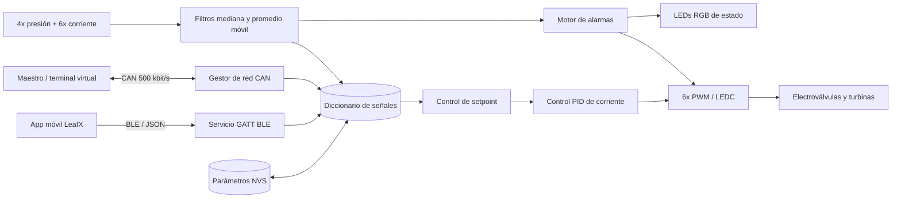

# SoilPress V2 — Firmware de control de presión hidráulica

**English:** [Read in English](README.md)


Firmware embebido de nivel productivo para **SoilPress**, una ECU de control de
presión agrícola que acciona electroválvulas y turbinas con control de corriente por
lazo cerrado (PID). Lee sensores de presión y corriente, ejecuta un motor de alarmas
en tiempo real y expone toda la máquina a través de una **red CAN** y una **app móvil
por BLE**.

Desarrollado sobre **ESP32-C6** con **ESP-IDF 5.3**, **FreeRTOS**, C y C++.

---

## Por qué este proyecto se destaca

- **Control en tiempo real:** 6 lazos PID independientes con período de 10 ms,
  control en modo corriente de actuadores hidráulicos, con rampas y detección de
  circuito abierto.
- **Cobertura embedded de punta a punta:** ADC interno y ADC externo por I2C, PWM/LEDC,
  LEDs RGB WS2812, persistencia en NVS, BLE GATT, CAN/TWAI y FreeRTOS en un solo MCU.
- **Criterio de producción:** calibración de parámetros, umbrales de alarma con
  temporizadores de debounce, diccionario de señales, helpers de CRC-32, build
  sellado con el hash del commit y validación de mensajes de commit en CI.
- **Arquitectura modular y prolija:** hardware, procesamiento de señales, control,
  comunicaciones y diagnóstico separados en módulos y tareas dedicadas.

---

## Qué hace el firmware

| Capacidad | Detalle |
|---|---|
| Salidas hidráulicas | 6 salidas PWM (LEDC) para electroválvulas, turbinas o sirena |
| Lazo cerrado | PID por salida sobre la corriente medida, con P/I/D y tiempo de sampleo configurables |
| Sensado de presión | 4 entradas analógicas de presión mediante ADC externo **TLA2528** de 8 canales por I2C |
| Sensado de corriente | 6 canales de ADC para realimentación 4–20 mA de los actuadores |
| Procesamiento de señal | Filtro de mediana + promedio móvil (profundidad configurable) antes del control y las alarmas |
| Motor de alarmas | 24 alarmas: presión alta/baja/mínima, desconexión de sensor, corriente mínima/máxima y pérdida de nodo; con retardos, criticidad, sirena e indicación RGB |
| Persistencia | Almacén clave/valor tipado en **NVS**: setpoints, tolerancias, calibración y ganancias PID |
| CAN | TWAI a 500 kbit/s, mensajería estilo J1939 por PGN, red multinodo maestro/esclavo |
| BLE | Servicio GATT estilo SPP con protocolo JSON consumido por la app **LeafX** |
| Diagnóstico | Diccionario de señales en vivo, forzado de señales, reconocimiento de alarmas, info de equipo y versión |
| Interfaz de estado | Dos LEDs RGB WS2812 para nivel de presión, estado de BLE y estado de alarmas |

---

## Arquitectura



### Modelo de tareas FreeRTOS

| Tarea | Prioridad | Período | Responsabilidad |
|---|---|---|---|
| `vTaskActuatorControl` | 10 | 10 ms | PID, PWM, detección de circuito abierto, sirena |
| `vTaskMemoryData` | 9 | 100 ms | Persistir parámetros modificados en NVS |
| `vTaskUpdateNetData` | 8 | 100 ms | Intercambio con el diccionario de señales / capa CAN |
| `vTaskAnalogData` | 8 | 1 ms | Muestreo de ADC, filtrado y publicación de sensores |
| `vTaskCanComm` | 8 | 1 ms | RX/TX de CAN y PGNs periódicos |
| `vTaskSetpoint` | 5 | 100 ms | Niveles de presión, indicadores LED y estado BLE |
| `vTaskBluetoothComm` | 1 | 20 ms | Manejo de mensajes BLE y respuestas JSON |

---

## Stack tecnológico

| Capa | Tecnología |
|---|---|
| Plataforma | Espressif ESP32-C6 (RISC-V), ESP-IDF 5.3 |
| RTOS | FreeRTOS (tareas, prioridades, temporización por tick) |
| Lenguajes | C, C++17 |
| Build | CMake + component manager de ESP-IDF |
| Protocolos | CAN/TWAI (500 kbit/s), BLE GATT, JSON (cJSON) |
| Periféricos | ADC1, PWM LEDC, I2C, GPIO, WS2812 vía `led_strip` |
| Almacenamiento | Partición NVS, tabla con 3 MB de app + 3 MB de storage |
| Herramientas | Git, conventional commits, workflow de gitlint en CI, clangd |

---

## Hardware y mapa de E/S

| Función | Interfaz |
|---|---|
| Sensores de presión | TLA2528 por I2C (`SDA` GPIO10, `SCL` GPIO11) |
| Realimentación de corriente | Canales ADC1 0–5 (4–20 mA con divisor resistivo) |
| Salidas PWM | GPIO18–GPIO23, timer low-speed de LEDC |
| Transceptor CAN | TX GPIO6, RX GPIO7, silent GPIO8 |
| LEDs RGB | GPIO17 y GPIO16 (WS2812) |
| Wake-up | GPIO15 |

> La asignación de pines está en `src/hardDefinitions.h`, que además habilita en
> compilación las funciones `CAN_ON` y `LED_RGB_PROCESS_ON`.

---

## Estructura del repositorio

```
FW_SoilPress_V2/
├── src/
│   ├── main.cpp                  # app_main, creación de tareas y cableado de módulos
│   ├── adcProcess.*              # Muestreo ADC/TLA2528 y filtrado
│   ├── pwmOut.*                  # PWM, control de corriente, rampas y circuito abierto
│   ├── pidController.*           # Algoritmo PID
│   ├── setpointControl.*         # Niveles de presión y setpoints
│   ├── alarms/                   # Motor de alarmas, tablas y manejo de sirena
│   ├── bluetooth/                # Stack BLE, protocolo JSON y ring buffer
│   ├── can/                      # Driver TWAI, PGNs y gestores de red y mensajes
│   ├── Dictionary/               # Diccionario de señales tipado con flags de estado
│   ├── SpecificFunctions/        # Filtros, timers, CRC-32, memoria, RGB y utilidades
│   └── TLA2528/                  # Driver I2C del ADC (basado en espp)
├── include/                      # Definiciones de app, tablas CAN y headers led_strip
├── tools/gitlint/                # Reglas de mensajes de commit usadas en CI
├── partitionsLpm.csv             # NVS + 3 MB app + 3 MB storage
├── sdkconfig                     # Configuración de ESP-IDF
└── CMakeLists.txt                # Registra src/ como componente de aplicación
```

---

## Cómo empezar

### Requisitos

- [ESP-IDF 5.3](https://docs.espressif.com/projects/esp-idf/en/v5.3/esp32c6/) instalado
  y exportado (`idf.py` disponible en la terminal).
- Una placa ESP32-C6 y un cable USB.
- Git.

### Compilar y flashear

```bash
git clone https://github.com/maurop25984/FW_PressureSoilModule_V2.git
cd FW_PressureSoilModule_V2

idf.py set-target esp32c6
idf.py build
idf.py -p COMx flash monitor
```

Reemplazá `COMx` por tu puerto serie (`/dev/ttyUSB0` en Linux/macOS). Salí del monitor
con `Ctrl+]`.

### Configuración

- `idf.py menuconfig` para opciones de ESP-IDF (tick de FreeRTOS, stack BLE, logs).
- `src/hardDefinitions.h` para habilitar/deshabilitar CAN, procesamiento RGB y pines.
- `partitionsLpm.csv` para el layout de flash.
- `src/version.h` se regenera en cada build desde `src/cmake/update_version.cmake`
  con el hash del commit actual.

---

## Protocolos de comunicación

**CAN** — 500 kbit/s con direccionamiento inspirado en J1939: dirección de origen 155
por defecto, PGNs para keep-alive, info de ECU, valor actual y pedido de cambio de
señales, forzado, reporte de alarmas, calibración y guardado/borrado de memoria. Un
gestor de red administra nodos maestros y esclavos.

**BLE** — servicio GATT expuesto como perfil de puerto serie. La app móvil envía
eventos JSON (`get_types`, `list_instances`, `get_instance`, `set_instance`,
`alarm_instance`, `alarm_recognition`, `clear_memory`) y recibe datos tipados de las
instancias más notificaciones de alarmas.

---

## Notas de ingeniería

- El lazo de control trabaja **en modo corriente**: el duty del PWM se ajusta con un
  PID para que la corriente medida del actuador siga el objetivo derivado del nivel
  de presión elegido, con calibración por salida y limitación de rampa.
- Las lecturas de presión y corriente se preprocesan con un **filtro de mediana** y
  luego un **promedio móvil**; además hay una implementación de filtro de Kalman
  disponible en `SpecificFunctions/filters.c`.
- Cada parámetro tiene un identificador tipado en el mapa de NVS, por lo que la
  calibración y la configuración sobreviven a los reinicios y se pueden modificar por
  BLE o CAN.
- Las alarmas usan temporizadores de debounce por alarma y pueden disparar la sirena,
  los LEDs RGB y notificaciones CAN, con reconocimiento desde la app.
- El build tolera warnings de componentes de terceros pero mantiene limpio el código
  propio, y los mensajes de commit se validan con conventional commits.

---

## Sobre el autor

Mauro Pivetta — Desarrollador de software embebido

GitHub: @maurop25984
Email: maurofpivetta@gmail.com
Áreas: firmware ESP32, CAN, IoT industrial, automatización y sistemas de control.
Disponible para proyectos de desarrollo embebido y consultoría técnica.
